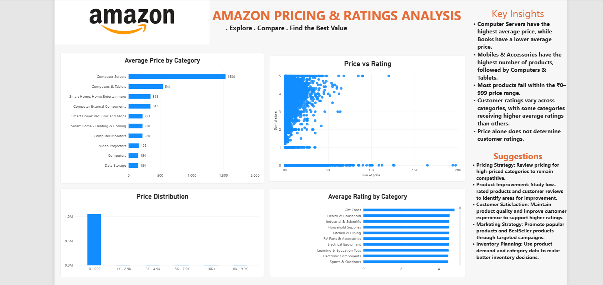
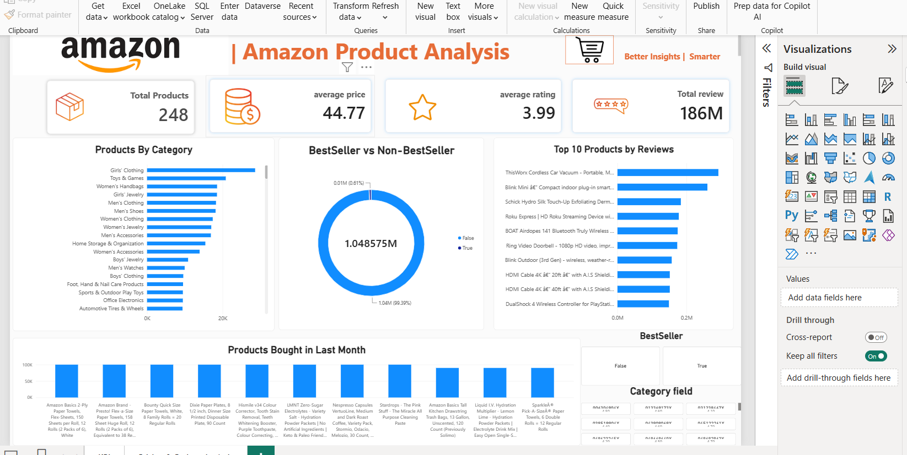

# Amazon Sales Analysis 📊

## 📌 Project Overview
This project analyzes Amazon sales data using Excel and Power BI to identify sales trends, key insights, and business opportunities.

## 🎯 Objectives
- Analyze sales performance.
- Identify important sales trends.
- Create interactive dashboards.
- Support data-driven business decisions.

## 🛠️ Tools Used
- Microsoft Excel
- Power BI
- Data Visualization

## 📈 Dashboards
### Dashboard 1

### Dashboard 2

## 📁 Project File

[Click here to view the Amazon Sales Analysis Project](https://drive.google.com/file/d/1fFjrK2cVCIS_WzZO8RFR82OlVCNWnFzN/view?usp=drive_link)

---
*This project was created for learning and practicing Data Analytics.*
